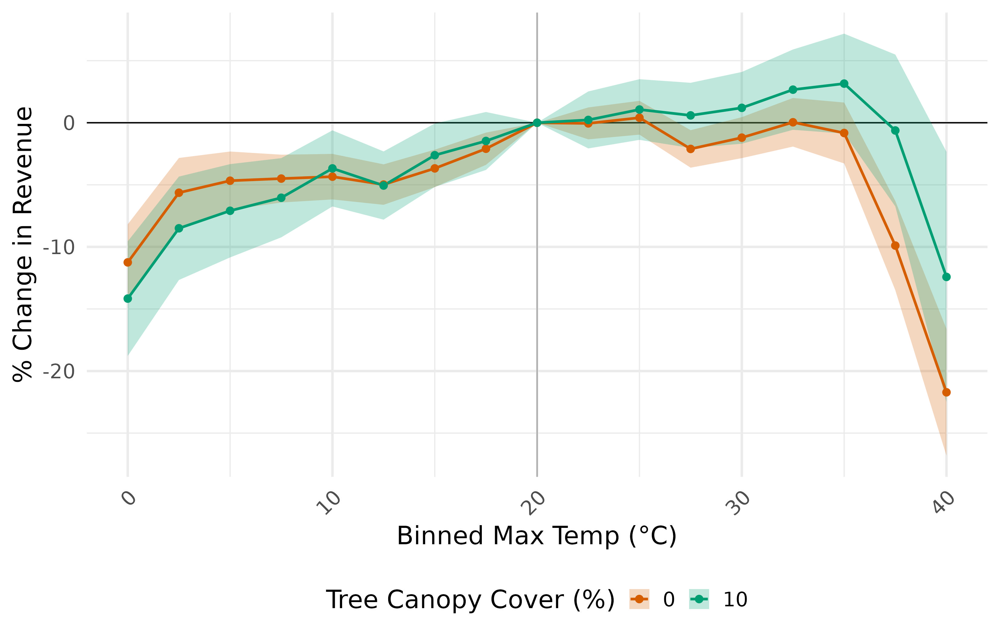
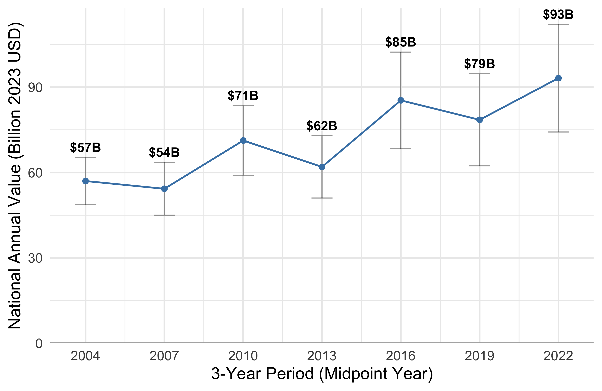

    

# Andie Creel 
I am an environmental economist and Postdoctoral Research Associate at the Yale School of the Environment, where I received my PhD in 2026. My research estimates the non-market value of nature-based adaptation solutions to climate change, ecosystem services, and conservation on working agricultural lands, with a focus on integrating these values into the systems that measure welfare, business performance, and fiscal health. I combine behavioral data, such as credit card transactions, mobility records, and time-use surveys, with high-resolution environmental data to reveal how natural resources influence well-being and economic outcomes.

I am on the 2026-2027 academic job market.

- [View and Download CV](creel_cv.pdf)
- [andie.creel@yale.edu](mailto:andie.creel@yale.edu)
- [LinkedIn](https://www.linkedin.com/in/andie-creel-7552b9b1/)

# Research

## *Job Market Paper*: The Value of Nature-Based Adaptation -- Evidence that Urban Tree Cover Protects Revenue from Heat

\[[Link to Working Paper.](working_papers/creel_jmp.pdf)\] Climate change is increasing the frequency and intensity of extreme heat events, particularly in cities. This paper estimates the causal effect of temperature on daily revenue using nearly 15,000 consumer-facing storefronts in the 49 largest U.S. cities between 2019 and 2023. Revenue peaks between 35 and 37.5 °C (95–99.5 °F) and then falls steeply, averaging 9 percent lower on days at or above 40 °C (104 °F) than on 20 °C (68 °F) days. Consumption smoothing across days mitigates some damage from an extreme heat event, but cumulative revenue remains about 1.4 percent lower nearly two weeks after a hot day. Therefore, I estimate how effective urban green space is as a climate adaptation strategy that can prevent revenue losses caused by extreme heat. I find that a one percent increase in tree cover surrounding a storefront increases revenue by about 0.9 percent on hot days (≥ 37.5 °C). Raising surrounding tree cover from zero to 10 percent eliminates revenue losses at 37.5 °C and nearly halves them at 40 °C. Storefronts located in the Southwest and South have the most to gain from urban tree cover. On average, businesses in this region can cover the cost of moving to a 10 percent tree cover scenario in four years with the avoided revenue losses. This length of time shortens under projected climate scenarios. These results suggest that green infrastructure can improve firm resilience to heat, providing evidence of a private incentive to finance urban green space that could simultaneously provide a positive externality.

*Revenue under 0% vs. 10% surrounding tree canopy, by daily maximum temperature (relative to a 20 °C day).*

## 20 Years of Local Outdoor Recreation and Its Value to Americans

*With Eli P. Fenichel*

\[[Link to Working Paper.](working_papers/creel_local_recreation.pdf)\] The value of outdoor recreation regularly justifies public spending on "the great outdoors." Yet 95 percent of recreation trips require an hour or less of round-trip travel. We develop an econometric approach that uses two decades of the American Time Use Survey (2003–2023) to produce repeated national estimates of the value of local recreation. A lower-bound estimate of willingness to pay per trip remained stable, between $5 and $6 (2023 USD), while national annual willingness to pay rose 63 percent, from $57.0 to $93.2 billion, driven by rising participation and population growth. Short trips to play with pets or children, walk, or socialize account for about 80 percent of outdoor recreation trips, yet these high-frequency activities are largely absent from the valuation literature. A relative price change framework, combined with weak complementarity, implies that publicly accessible outdoor spaces have not become scarcer, consistent with sustainable management nationally.

*Annual national value of access to local outdoor recreation, 2003–2023 (billions of 2023 USD; three-year periods plotted at midpoint year, 95% confidence intervals).*

# Work in Progress

## Measuring the Value of Outdoor Recreation for National Environmental-Economic Statistics

*With Jorge Forero Fajardo and Eli P. Fenichel*

\[[Link to Working Paper.](working_papers/simple_pdfs/creel_sat_accnt.pdf)\] The 2025 System of National Accounts establishes that comprehensive expenditure measurement across accounting boundaries can support welfare assessment. For ecosystem services like outdoor recreation, this requires comprehensive partitioning of expenditure between the System of National Accounts (SNA) boundary for market transactions and the household production boundary for travel time. Current U.S. satellite accounts fail to do this. The Outdoor Recreation Satellite Account captures only market expenditures for distant trips, while the Household Production Satellite Account excludes recreation entirely. We use detailed U.S. coastal recreation data to partition travel costs across these boundaries and quantify the resulting measurement gaps. Our central finding is that outdoor recreation is primarily a household-produced service. Travel time, not market purchases, represents the major expenditure. Household production values are approximately twice market expenditures, meaning assessments based only on market spending underestimate recreation's contribution to well-being by roughly threefold. Including recreation travel time would increase the Household Production Satellite Account by 4–5 percent nationally ($12.4 billion in the Gulf Region, or 0.7 percent of regional GDP). These measurement gaps have policy consequences: benefit-cost analyses that rely solely on market expenditures systematically understate recreation benefits, potentially leading to underinvestment in environmental protection and recreational infrastructure.

## Two Wedges and No Wire: Externalities in Virtual Fence Adoption

*With Katherine Lee and Sophie Gilbert*

Virtual fence (VF) technologies have the potential to lower private costs for cattle producers and create the conditions to provide environmental co-benefits more easily. However, we show that decentralized adoption is inefficiently low. We develop a two-stage model of VF adoption among heterogeneous producers to characterize how two distinct market failures drive a wedge between private and social incentives to adopt. We model how uncertainty about VF's private benefits creates a transitory learning externality that dissipates as learning resolves uncertainty about VF's performance. However, we also show that even after uncertainty is fully resolved, producers may not use VF for conservation management unless they are compensated for additional environmental benefits they generate. This environmental externality is persistent even under complete information. We distinguish additional conservation from conservation producers would undertake on their own, since efficient payments should target only the conservation that would not occur without a payment. We decompose the total welfare loss from decentralized adoption of VF into a transitory learning loss and a persistent conservation loss, and show that a producer-differentiated payment equal to the social value of additional conservation closes the environmental wedge. We use this framework to evaluate existing VF adoption subsidies and conservation programs and argue that policy will eventually need to shift from subsidizing early adoption toward payments for additional conservation as learning resolves uncertainty.

## Valuing Soil as Natural Capital: The Shadow Price of Soil Organic Matter in U.S. Agriculture

*With Mark Bradford, Eli P. Fenichel, Michael Meneses, and Alexander Polussa*

We estimate the economic value of soil organic matter as a natural capital input to the production of major U.S. field crops. Because soil organic matter is a stock that responds to management and in turn affects yields, its value is not directly observed. We recover its shadow price from farmers' observed choices of crops, tillage, and cover cropping across the contiguous United States.

## Virtual Fencing and Riparian Conservation on Western Rangelands

*Supported by the Property and Environment Research Center (PERC)*

I use spatial boundaries from virtual fence projects across the western United States and satellite vegetation data in riparian buffers to measure whether virtual fence grazing management improves riparian habitat.
